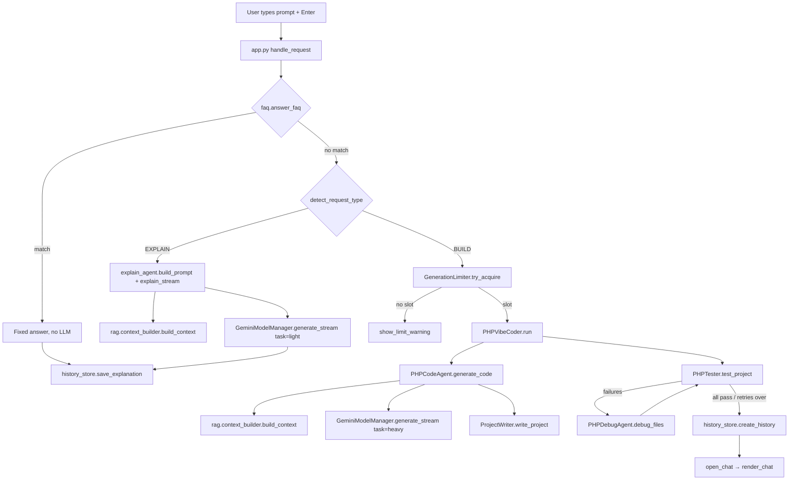

# PHP Vibe Coding — Execution Flow

This document follows a request from the moment the user presses Enter
until the answer is on screen, file by file and function by function.

---

## 1. Big picture

```
User (browser)
   │
   ▼
streamlit_app/app.py ── render_home() / render_chat() / render_explanation()
   │
   ├─► agents/faq.py ............ question about this app  → fixed answer, no LLM
   ├─► agents/intent_router.py .. EXPLAIN or BUILD?
   │
   ├─ EXPLAIN ─► agents/explain_agent.py ─► rag/ ─► agents/gemini_model_manager.py
   │                                                   └─► agents/fallback_providers.py (Groq / NVIDIA)
   │
   └─ BUILD ───► streamlit_app/rate_limiter.py (slot)
                 agents/vibe_coder.py
                   ├─► agents/code_agent.py ─► rag/ ─► model manager ─► agents/project_writer.py
                   ├─► agents/php_tester.py  (php -l)
                   └─► agents/debug_agent.py (fix) ─► php_tester again
                 streamlit_app/history_store.py (save chat)
```



---

## 2. Startup (every Streamlit rerun)

Streamlit re-runs `streamlit_app/app.py` from top to bottom on every click
or message. Order inside the file:

| Step | Code | What happens |
|---|---|---|
| 1 | imports | Loads all agents. `agents/gemini_model_manager.py` calls `load_dotenv()`, so `.env` keys are available. |
| 2 | `st.set_page_config` | Page title "PHP Vibe Coder", wide layout. |
| 3 | `defaults` loop | Creates `st.session_state` keys: `active_chat`, `active_explanation`, `current_project`, … |
| 4 | Helper functions | `get_project_files`, `read_project_file`, `build_generation_summary`, `make_live_preview`, `show_explanation`, … are defined. |
| 5 | CSS block + `chat_bubble()` | Theme tweaks; `chat_bubble(role)` wraps `st.chat_message` with 🐘 / 🧑‍💻 avatars. Colours come from `.streamlit/config.toml`. |
| 6 | Sidebar | Brand, **＋ New chat** (`start_new_project`), search box, empty `history_container`, **🛠 Tools** radio (`mode`), `usage_placeholder`. |
| 7 | Page dispatch | See next table. |
| 8 | `render_history_sidebar()` | Fills the history list (runs last so new chats appear immediately). |
| 9 | `render_usage_sidebar()` | "● 5/5 generations" badge from `generations_left()`. |

**Page dispatch** (decided by session state):

```python
if st.session_state.active_explanation:  render_explanation(id)
elif st.session_state.active_chat:       render_chat(project)
elif mode == "Generate Project":         render_home()
elif mode == "Project Workspace":        ...   # Tools pages
elif mode == "Understand Code":          ...
elif mode == "Refactor Code":            ...
elif mode == "Test Project":             ...
```

---

## 3. Home page: `render_home()` (app.py)

1. Draws `st.chat_input(..., accept_file=True, key="home_input")`.
   Enter submits; Shift+Enter is a new line.
2. Gets the prompt from **either**
   - the chat box (`value.text`, and `attachment_from_chat_input(value)`
     saves an attached file with `save_uploaded_file()` into
     `uploaded_files/`), **or**
   - an example card: the card's `on_click=queue_prompt` stored the text
     in `st.session_state.pending_prompt`.
3. If there is a prompt → `handle_request(prompt, attachment)`; if it
   returns `True` → `st.rerun()` so the finished chat opens.
4. If there is no prompt → shows the empty state ("PHP Vibe Coding",
   six example cards).

---

## 4. `handle_request(requirement, attachment)` (app.py) — the router

```
handle_request
 ├─ chat_bubble("user")  → shows the prompt (+ attachment name)
 │
 ├─ faq_answer(requirement)                      ← agents/faq.py
 │     └─ answer_faq() → find_faq() → regex match
 │           match  → show answer → save_explanation(model="built-in FAQ")
 │                    → open_explanation(id) → return True   (NO LLM CALL)
 │
 ├─ detect_request_type(requirement, "Auto")     ← app.py
 │     ├─ rule_based_intent(text)                ← agents/intent_router.py
 │     │     QUESTION_START / EXPLAIN_PATTERNS / BUILD_PATTERNS regexes
 │     └─ if rules unsure → classify_intent(text, GeminiModelManager())
 │           └─ model_manager.generate(prompt, max_output_tokens=8, task="classify")
 │
 ├─ EXPLAIN → section 5
 └─ BUILD   → section 6
```

---

## 5. Explanation flow (no project is built)

```
handle_request
 └─ show_explanation(question)                         app.py
     ├─ PHPExplainAgent()                              agents/explain_agent.py
     │    └─ GeminiModelManager()                      (model manager, section 8)
     ├─ agent.build_prompt(question)
     │    ├─ _search_query(question, history)          adds earlier questions for follow-ups
     │    ├─ get_rag_context(query)
     │    │    └─ PHPContextBuilder(top_k=3).build_context(query)   rag/context_builder.py
     │    │         └─ get_retriever() (cached) → PHPRetriever.retrieve(query)  rag/retriever.py
     │    │              embed query (all-MiniLM-L6-v2) → FAISS search → top 3 PHP-manual chunks
     │    ├─ language_instruction(question)            agents/reply_language.py
     │    │    └─ detect_reply_language() → English / Hinglish / Hindi rule
     │    └─ prompt text (first-question format, or follow-up format)
     ├─ st.write_stream(agent.explain_stream(prompt))
     │    └─ model_manager.generate_stream(prompt, task=TASK_LIGHT)
     │         → Groq → NVIDIA → Gemini (section 8)
     └─ save_explanation(question, answer, model)      streamlit_app/history_store.py
          → chat_history/explanations/<id>.json
 handle_request → open_explanation(id) → return True → st.rerun()
```

**Follow-up questions:** `render_explanation(id)` shows the saved
question/answer and `record["messages"]`, then a chat box.
On submit:

1. `faq_answer(question)` first (no LLM if it matches),
2. else `PHPExplainAgent().build_prompt(question, history=…)` +
   `explain_stream()`,
3. `append_explanation_message(...)` saves both messages.

---

## 6. Project generation flow

### 6.1 Rate limit — `streamlit_app/rate_limiter.py`

```
handle_request
 └─ get_generation_limiter()            @st.cache_resource → one GenerationLimiter per server
     .try_acquire(current_user_id())
        current_user_id() → user_id_from_context(st.context)
                            X-Forwarded-For / ip_address → sha256 hash
        per-user (5 / 10 min) and global (40 / hour) checks
   ├─ not ok → show_limit_warning(reason, wait) → stop
   └─ ok     → slot_token kept (released again if generation fails)
```

### 6.2 Orchestration — `agents/vibe_coder.py`

```
handle_request
 ├─ make_project_name(requirement)                     app.py (stopwords removed → "todo-mysql")
 ├─ make_live_preview(live, status, progress)          app.py → on_progress callback
 └─ PHPVibeCoder(max_retries=3).run(requirement, project_name,
                                    attachment_path, attachment_type, on_progress)
      │
      ├─ STEP 1  generate_project(...)
      │           └─ PHPCodeAgent.generate_code(...)          agents/code_agent.py
      │
      └─ STEP 2  for attempt in 1..3:
                   test_project(project_dir)
                     └─ PHPTester.test_project(dir)           agents/php_tester.py
                   PHP not installed   → return success, validated=False
                   0 failures          → return success, validated=True
                   failures, attempts left → debug_project(report)
                   failures, last attempt  → return success=False
```

### 6.3 Code generation — `agents/code_agent.py`

`PHPCodeAgent.generate_code()` tries the cheapest way first:

```
generate_code(requirement, project_name, attachment_path, attachment_type, on_progress)
 │
 ├─ 1. EXACT CACHE   _cache_key() → _read_cache()           .cache/generations/<key>.json
 │      hit → ProjectWriter.write_project(cached) → _apply_templates()      (no model call)
 │
 ├─ 2/3. SIMILAR PROJECT (no attachment)                    agents/project_memory.py
 │      self.memory.find(requirement)
 │         embeds the requirement with the RAG model (all-MiniLM-L6-v2),
 │         compares with tested projects in .cache/project_memory.json
 │      ├─ REUSE (score ≥ 0.90 and no new important words)
 │      │     copytree(old project → new project)                         (no model call)
 │      └─ ADAPT (score ≥ 0.80)
 │            copytree(old → new)
 │            build_adapt_prompt(): base project files + new requirement
 │            _ask_model() → model writes ONLY changed/new files (+ DELETE: lines)
 │            _apply_deletes() → write_project(changed files) → _apply_templates()
 │            (any error → falls through to full generation)
 │
 └─ 4. FULL GENERATION
        build_prompt():
          BASE_INSTRUCTIONS + PHP_QUALITY_RULES + TEMPLATE_INSTRUCTIONS + OUTPUT_FORMAT
              ↑ identical on every request → Gemini implicit prompt cache
          + RAG docs (rag.context_builder) + attachment note + USER REQUIREMENT
              ↑ per request, always at the END
        complexity.estimate(requirement) → thinking "low" | "medium" | "high"
          (feature words + hard topics such as payments, roles, booking
           conflicts; a fixed GEMINI_THINKING_LEVEL in .env wins)
        _ask_model(..., thinking_level):
          on_progress → model_manager.generate_stream(... max_output_tokens=32768,
                                                       thinking_level)
                         → Gemini thinking_config / Groq gpt-oss reasoning_effort
                         → make_live_preview.on_progress() shows ✓ / ⏳ files
          else        → model_manager.generate(...)
        ProjectWriter.write_project()   extract_files() + validate_path()
        _apply_templates()   copies templates/php_base/ (config/database.php,
                             src/Database.php, .env.example) when the code uses
                             Database:: and the request did not opt out
                             (mysqli, sqlite, laravel, "no database", ...)
        _complete_missing()                                   agents/feature_checker.py
          find_missing(): requirement + trimmed code → small model (task light)
                          → {"missing": [...]}
          missing → one more call (COMPLETE_INSTRUCTIONS) writes only the
                    files that add those features → write_project()
          (also runs after ADAPT; FEATURE_CHECK=off disables it)
        _write_cache()   (first answer + completion, so a cache hit is complete)
 → _result(): files, model, source = "cache" | "reuse" | "adapt" | "generated"
```

### 6.4 Testing and auto-fix

```
PHPTester.test_project(project_dir)                    agents/php_tester.py
 ├─ find_php_files()         all *.php
 └─ test_file(path)          subprocess: php -l <file>

PHPVibeCoder.debug_project(report)                     agents/vibe_coder.py
 ├─ 1. local_fix(code)        agents/debug_agent.py     (no AI)
 │       BOM, leftover ``` fences, missing <?php  → test_file() again
 ├─ 2. PHPDebugAgent.debug_files_patch(dir, remaining)  task=TASK_LIGHT (Groq first)
 │       numbered(): file with line numbers (window ±40 around the error for long files)
 │       model replies only "@@ start-end @@" blocks → parse_patches() → apply_patches()
 ├─ 3. PHPDebugAgent.debug_files(dir, still_broken)     task=TASK_LIGHT, whole files (fallback)
 └─ write_fixed_file()       only files that were reported broken
 → back to test_project()  (up to 3 rounds)

On success: PHPVibeCoder._remember() → PHPCodeAgent.remember_project()
            → ProjectMemory.remember()  (so later similar requests can reuse it)
```

### 6.5 After generation (app.py)

```
handle_request
 ├─ create_history(project, requirement,
 │                 summary=build_generation_summary(result, files), model)
 │     history_store.py → chat_history/<project>.json
 │     messages = [user requirement, assistant summary]
 ├─ open_chat(project)   → st.session_state.active_chat = project
 └─ return True → st.rerun() → page dispatch → render_chat(project)
 (on exception: limiter.release(slot_token) + show_error())
```

---

## 7. Project chat — `render_chat(project)` (app.py)

```
render_chat(project)
 ├─ get_or_create_history(project, dir)          history_store.py
 ├─ messages loop (chat_bubble per message)
 │    after the summary message → project_panel():
 │       ├─ 📁 Files expander → render_project_files()  (radio of files + st.code)
 │       └─ render_project_actions()
 │            ├─ 📥 Download ZIP  → project_zip_bytes(project)  (in-memory zip)
 │            ├─ ▶ How to run / 🔍 Explain structure / ✏️ Add a feature
 │            │      on_click=queue_project_question(text) → pending_question
 │            ├─ 🧪 Run tests     on_click=queue_project_tests → pending_tests
 │            └─ render_single_file_download()  (dropdown + ⬇ Download file)
 ├─ st.chat_input("Ask anything about <project>…")
 │
 ├─ pending_tests → PHPTester().test_project() → test_report_markdown()
 │                  → append_message() ×2                (no LLM)
 │
 └─ question (typed or pending_question)
      PHPCodeUnderstandingAgent()                  agents/code_understanding_agent.py
       .build_prompt(project_path, question, history, requirement)
          ├─ build_project_context() → PHPProjectAnalyzer(dir).build_context()
          │        agents/project_analyzer.py: files, namespaces, classes, functions, code
          ├─ get_rag_context(question)             rag/
          ├─ format_history(history)               last 6 messages
          └─ language_instruction(question)        agents/reply_language.py
       .ask_stream(prompt) → model_manager.generate_stream(task=TASK_LIGHT)
      append_message(user) + append_message(assistant)   history_store.py
```

---

## 8. Model manager — how every LLM call travels

All agents call `GeminiModelManager.generate()` or `.generate_stream()`
(`agents/gemini_model_manager.py`). The `task` argument decides the order:

| task | Used by | Order |
|---|---|---|
| `TASK_HEAVY` (default) | code_agent, refactor_agent | Gemini → Groq → NVIDIA |
| `TASK_LIGHT` | explain_agent, code_understanding_agent, rag_agent, debug_agent | Groq → NVIDIA → Gemini |
| `TASK_CLASSIFY` | intent_router.classify_intent | smallest Groq model first → NVIDIA → Gemini |
| any task **with an image** | — | Gemini first (only Gemini reads images) |

```
generate(prompt, …, task)
 ├─ _fallback_first(task, attachment_type)   light/classify and no photo?
 ├─ steps = [fallback, gemini]  or  [gemini, fallback]
 │
 ├─ gemini step: _generate_gemini()  /  _stream_gemini()
 │     for model in _ordered_models():          GEMINI_MODELS, last good model first
 │        skip if _unavailable_models (404) or _is_cooling_down()
 │        config = _make_config(model, max_tokens)  → _effective_thinking():
                 adaptive level from the caller, or fixed GEMINI_THINKING_LEVEL
 │        client.models.generate_content(_stream)(...)
 │        errors:
 │          thinking rejected → _thinking_rejected() → retry without it
 │          429 PerDay        → _set_cooldown(until Pacific midnight, _seconds_until_quota_reset)
 │          429 per-minute    → wait only if not _can_skip(); else cooldown + next model
 │          404               → mark unavailable
 │          5xx               → retry only if nothing else can answer
 │
 └─ fallback step: FallbackProviders.generate() / generate_stream()   agents/fallback_providers.py
       entries from GROQ_MODELS / NVIDIA_MODELS (one per provider+model)
       _ordered(small_first)   skips 404 models and models cooling down
       _request() → OpenAI-style POST /chat/completions (urllib)
       _handle_http_error():
         400 + extra params → retry without (reasoning_effort / reasoning_format)
         404 → model unavailable;  429 → cooldown for THAT model only;  413 → next model
```

---

## 9. Tools pages (sidebar → 🛠 Tools)

| Page | Main calls |
|---|---|
| Project Workspace | `select_project()` → file `selectbox` → `read_project_file()` → `st.code` (view only) |
| Understand Code | `PHPCodeUnderstandingAgent().ask(project_path, question)` → `build_prompt()` + `model_manager.generate(task=light)` |
| Refactor Code | `PHPRefactorAgent().refactor_file(...)` (task heavy) → `write_refactored_file()` |
| Test Project | `PHPTester().test_project(dir)` → `display_test_result()` |

---

## 10. RAG index (offline, run once)

```
rag/ingest.py        process_documents()
                       is_relevant_file() → extract_xml_text() → clean_text()
                       → create_chunks() (overlapping) → knowledge_base/chunks/php_chunks.jsonl
rag/build_index.py   main()
                       load_chunks() → build_index() (all-MiniLM-L6-v2 via fastembed, FAISS)
                       → save_metadata()
rag/retriever.py     PHPRetriever (loads model + index once per process)
rag/context_builder.py
                     get_retriever() @lru_cache → PHPContextBuilder.build_context(query)
                     → top-k chunks, each trimmed to 1500 chars
```

---

## 11. Where data is stored

| Path | Written by | Content |
|---|---|---|
| `generated_projects/<project>/` | `ProjectWriter.write_project`, debug/refactor agents | the generated PHP project |
| `chat_history/<project>.json` | `create_history`, `append_message` | project chat |
| `chat_history/explanations/<id>.json` | `save_explanation`, `append_explanation_message` | explanation chats (and FAQ answers) |
| `uploaded_files/` | `save_uploaded_file` | files attached in the chat box |
| `.cache/generations/<hash>.json` | `PHPCodeAgent._write_cache` | cached model answers for identical requests |
| `.cache/project_memory.json` | `ProjectMemory.remember` | embeddings of tested projects, for reuse / adapt |
| `templates/php_base/` | you (fixed files) | secure PDO `Database` class, config and `.env.example` added to projects |
| server memory | `GenerationLimiter` | rate-limit counts (reset on restart) |
| `.env` / Streamlit secrets | you | API keys, model lists, limits |

---

## 12. One example, end to end

Prompt: **"Create a PHP to-do app with MySQL"**

1. `render_home` → `handle_request`
2. `faq_answer` → no match
3. `detect_request_type` → `rule_based_intent` matches BUILD ("create … app")
4. `GenerationLimiter.try_acquire` → slot taken (4/5 left)
5. `make_project_name` → `todo-mysql`
6. `PHPVibeCoder.run` → `PHPCodeAgent.generate_code`
   → exact cache miss → `ProjectMemory.find` finds no similar project
   → RAG docs → `generate_stream(task=heavy)` → Gemini `gemini-3.8-flash`
   → live preview shows `✓ index.php ⏳ config/database.php …`
   → `ProjectWriter.write_project` saves the files
7. `PHPTester.test_project` → all `php -l` pass → `validated=True`
   → `_remember()` stores it in `.cache/project_memory.json`
8. `create_history` → `open_chat("todo-mysql")` → `st.rerun()`
9. `render_chat` shows summary, files, Download ZIP, single-file dropdown,
   action buttons, and the "Ask anything about todo-mysql…" box
10. User asks "yeh project kaise chalaun?" →
    `PHPCodeUnderstandingAgent` → `generate_stream(task=light)` → Groq
    → answer in Hinglish (`reply_language`) → `append_message`